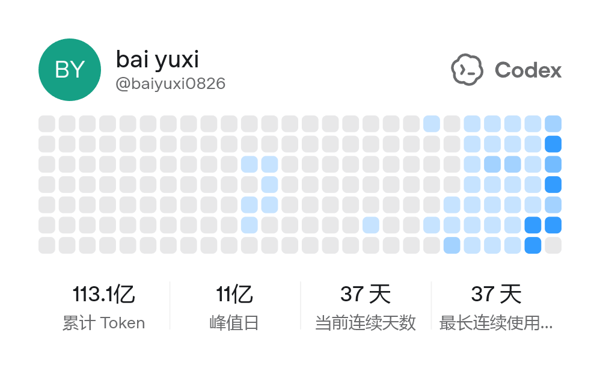

# Sanitized Codex Session Evidence

## Session metadata

- Session ID: `019f6e1c-30b0-7a02-9b40-e84016be70bd`
- Model: `gpt-5.6-sol`
- Submission period: OpenAI Build Week 2026
- Evidence type: local Codex session metadata and verified repository actions

## Supplemental public usage context

This Codex-generated profile card provides supplemental public context that the submitter is an active Codex user. It is not used as standalone proof that GPT-5.6 produced a specific change. Project-level attribution remains anchored to the `/feedback` session ID above, the Build Week scope record, and the verified repository actions below.

## Work represented

The session covered repository mapping, competition-scope separation, review of the explicit thread-title candidate flow, release and test verification, and Build Week submission preparation.

A later Build Week Codex session performed the full credential/history audit and created this sanitized public distribution.

## Privacy boundary

This file intentionally excludes raw prompts, transcripts, credentials, cookies, environment values, internal host identifiers, private repository metadata, and local filesystem paths.

## Related evidence commits

- `cd325186223dc41b2c3eb3fdf256d80d5442b256`
- `baa6a5bab2f862001662b94a88c2ae414ff35fc6`
- `9f20b82404dee33e603277ad3ee980f1a1323af0`
- `b23db5681192c56c1f9a51bcef939608487bdb45`

See [BUILD_WEEK.md](../../BUILD_WEEK.md) for the precise eligible scope.
